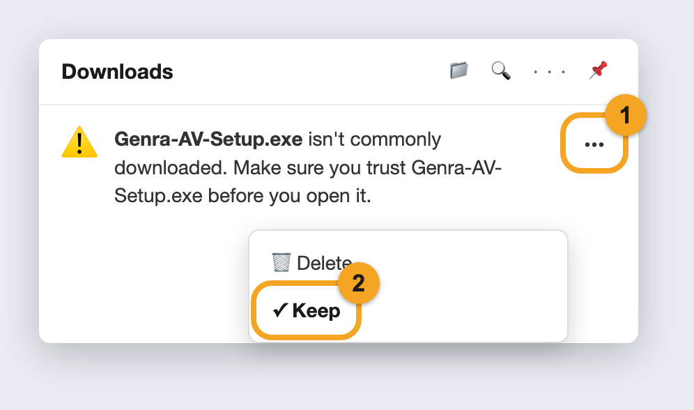
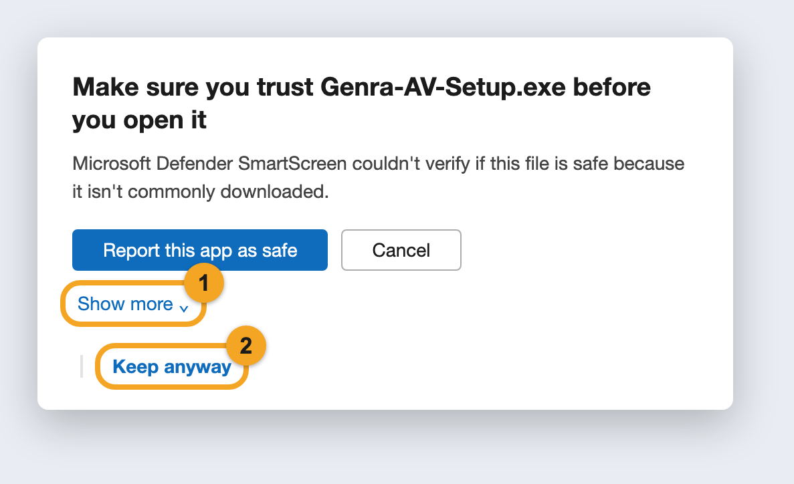
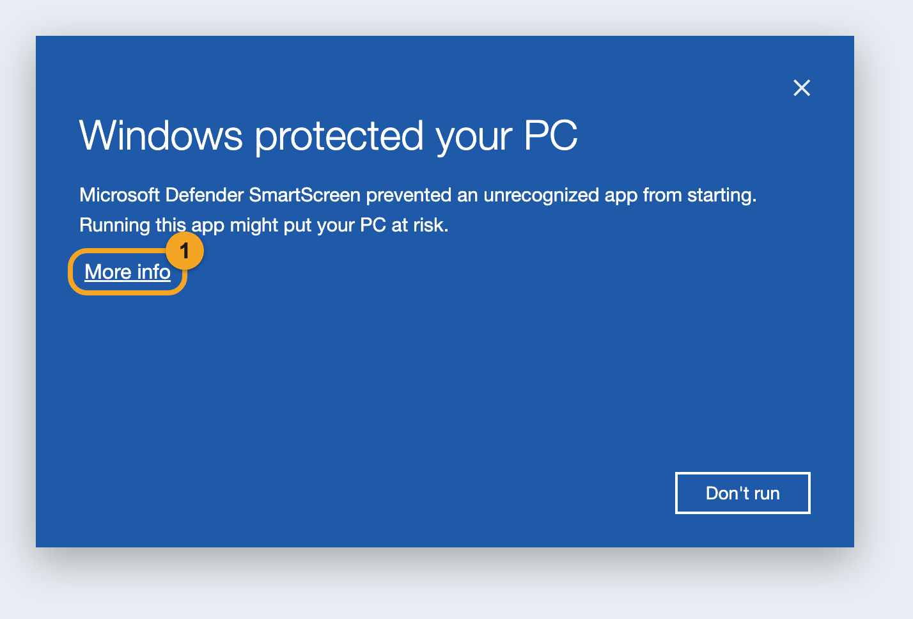
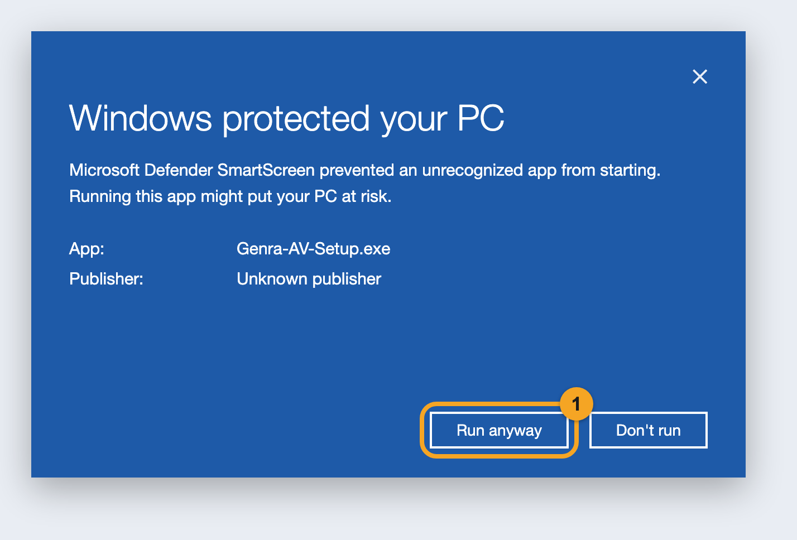
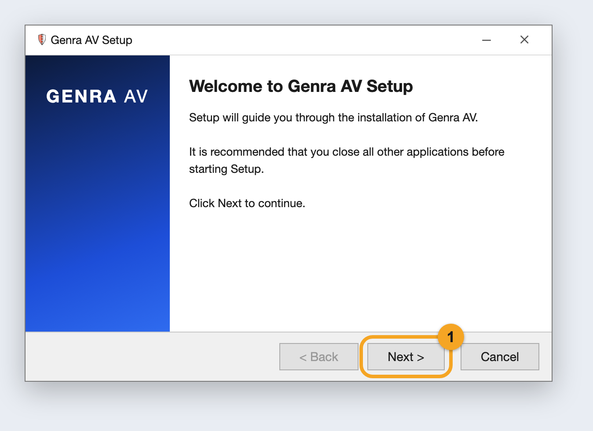
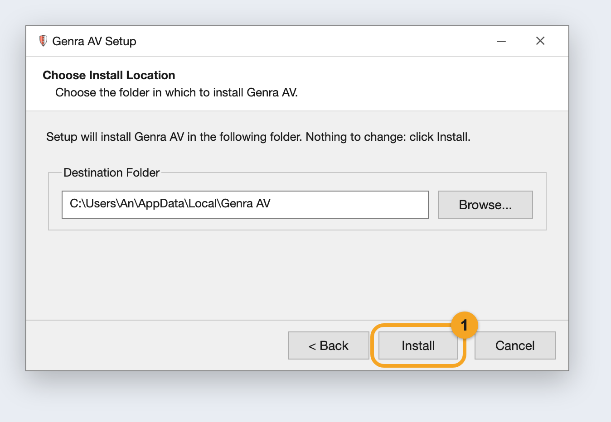
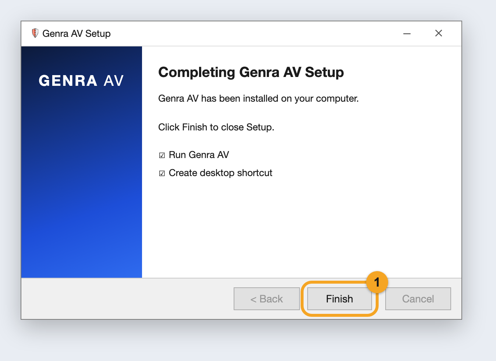

# Install Genra AV on Windows

[Tiếng Việt](windows.vi.md)

About 2 minutes, no administrator rights needed. Genra runs next to Windows Defender, not in its place.

> **Why does Windows warn?** Genra is new and does not yet carry a paid code-signing certificate,
> so Windows and the Edge browser do not "know" it yet and ask you twice. The warning does not mean
> the file has a virus. Follow these steps only for a file downloaded from
> **github.com/craft-the-code/genra-av/releases**.

The pictures are illustrations; your screen may look slightly different. The numbered yellow boxes
are what to click, in order.

## 1. Download the installer

Open the [Genra AV downloads page](https://github.com/craft-the-code/genra-av/releases), take the
newest version at the top, scroll to **Assets** and click **`Genra-AV-Setup.exe`**.

## 2. Keep the file in Edge

Edge may say the file "isn't commonly downloaded". Click the **···** next to it, then **Keep**.

Edge asks again: click **Show more**, then **Keep anyway**.

Chrome and other browsers may skip this step, or show a similar **Keep** button.

## 3. Open the file and let Windows run it

Double-click `Genra-AV-Setup.exe` (in the downloads list or the **Downloads** folder). Windows shows a
blue box, **"Windows protected your PC"**. Click **More info**.

Check that **App** reads `Genra-AV-Setup.exe`, then click **Run anyway**.

No **Run anyway** button? Installing software may be locked on a work computer: ask whoever looks
after your office's computers.

## 4. Install

Click **Next >**.

No need to change the folder: click **Install**.

Leave both boxes ticked and click **Finish**.

## 5. Done

Genra AV opens and runs its first quick scan by itself (Downloads, Desktop, Documents, Zalo, USB
sticks). Nothing else to do. Each time it opens, Genra brings its detection rules up to date.

## Questions

- **Do I need to remove Windows Defender or another antivirus?** No. Genra runs next to them.
- **What about new versions?** Download the new installer and install it over the old one with the
  same steps; history and quarantined files are kept. From the official release on, Genra tells you
  about new versions and updates itself in the app.
- **How do I uninstall Genra?** Windows **Settings** → **Apps** → find **Genra AV** → **Uninstall**.
- **Want to check the download yourself?** The downloads page has a `SHA256SUMS` file; how to check
  it is in [docs/releasing.md](../releasing.md) ("Verify a download").
