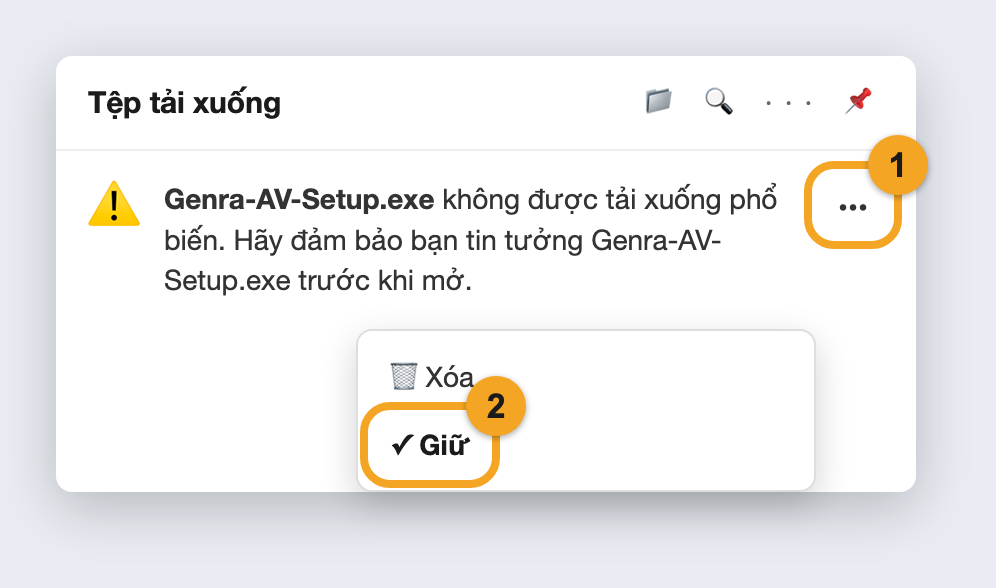
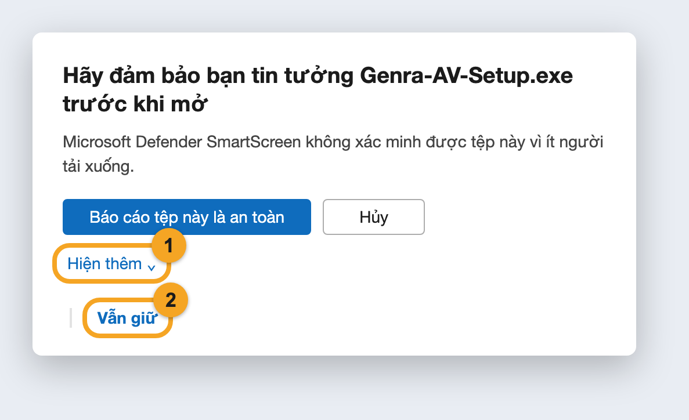
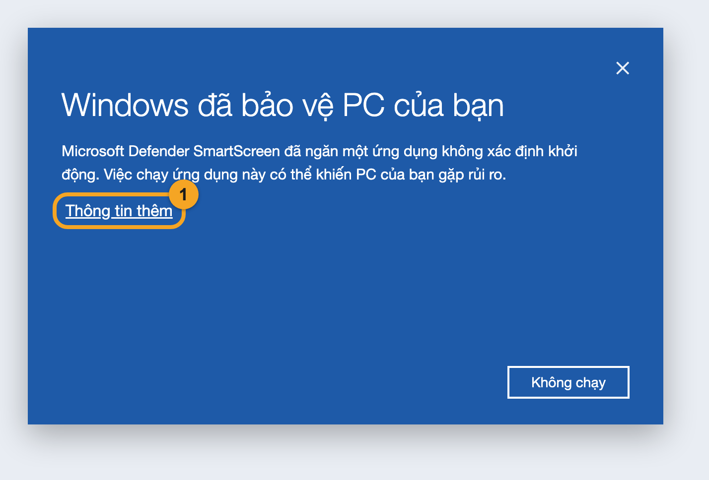
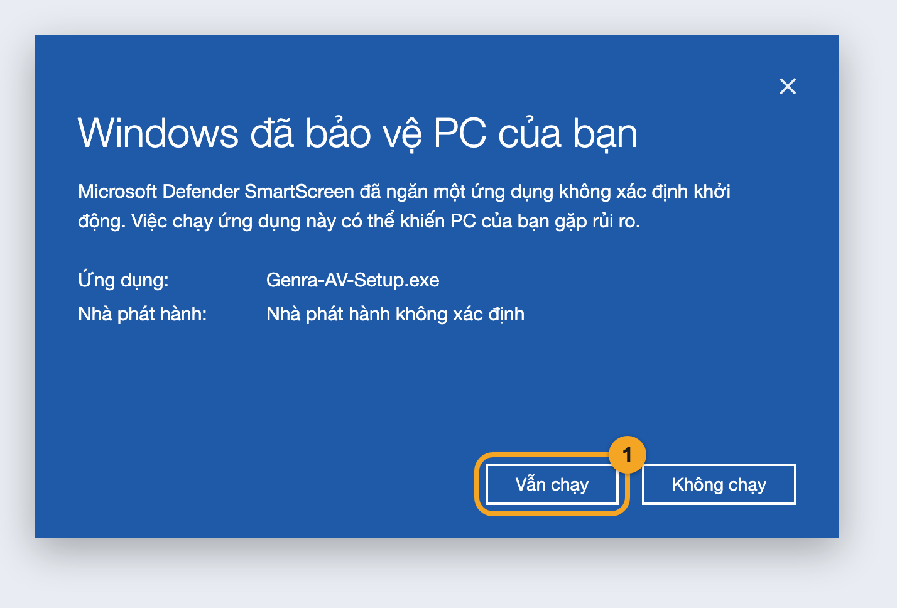
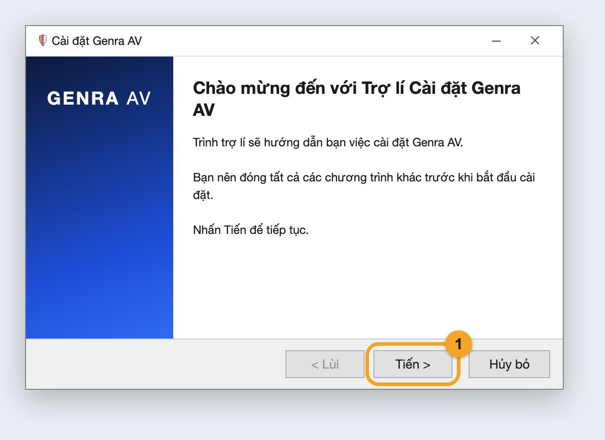
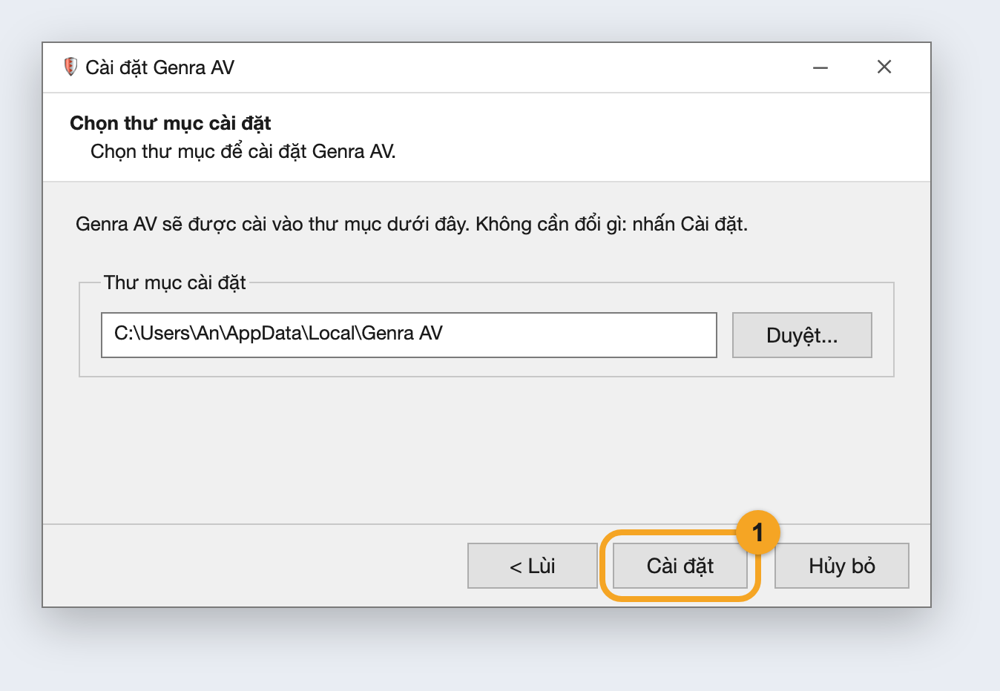
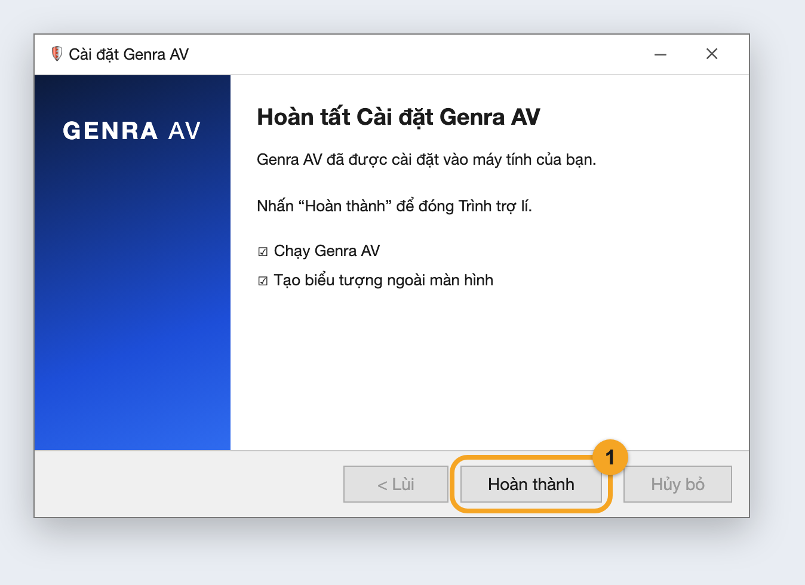

# Cài Genra AV trên Windows

[English](windows.en.md)

Mất khoảng 2 phút, không cần quyền quản trị. Genra chạy cùng Windows Defender, không thay thế nó.

> **Vì sao Windows hiện cảnh báo?** Genra là phần mềm mới, chưa mua chữ ký số của Microsoft, nên
> Windows và trình duyệt Edge chưa "quen" nó và hỏi lại bạn hai lần. Cảnh báo này không có nghĩa là
> tệp có virus. Chỉ làm theo các bước dưới đây khi bạn tải tệp từ đúng trang
> **github.com/craft-the-code/genra-av/releases**.

Các hình dưới đây là hình minh hoạ, máy bạn có thể khác một chút. Ô vàng có số là chỗ cần bấm, theo
thứ tự.

## 1. Tải tệp cài đặt

Mở [trang tải Genra AV](https://github.com/craft-the-code/genra-av/releases), chọn bản mới nhất ở
trên cùng, kéo xuống mục **Assets** và bấm **`Genra-AV-Setup.exe`**.

## 2. Giữ tệp trong Edge

Edge có thể báo tệp "không được tải xuống phổ biến". Bấm dấu ba chấm **···** cạnh tệp, rồi chọn
**Giữ**.

Edge hỏi lại: bấm **Hiện thêm**, rồi **Vẫn giữ**.

Dùng Chrome hay trình duyệt khác thì có thể không có bước này, hoặc có một nút tương tự là
**Giữ lại**.

## 3. Mở tệp và cho Windows chạy nó

Bấm đúp tệp `Genra-AV-Setup.exe` (trong danh sách tải xuống hoặc thư mục **Tải xuống**). Windows hiện
một hộp màu xanh **"Windows đã bảo vệ PC của bạn"**. Bấm dòng chữ **Thông tin thêm**.

Kiểm tra dòng **Ứng dụng** là `Genra-AV-Setup.exe`, rồi bấm **Vẫn chạy**.

Không thấy nút **Vẫn chạy**? Máy cơ quan có thể bị khoá việc cài phần mềm: hãy nhờ người phụ trách máy
tính của cơ quan.

## 4. Cài đặt

Trình cài đặt bằng tiếng Việt. Bấm **Tiến >**.

Không cần đổi thư mục: bấm **Cài đặt**.

Để nguyên hai ô đã đánh dấu và bấm **Hoàn thành**.

## 5. Xong

Genra AV tự mở và tự quét nhanh máy lần đầu (Tải xuống, Desktop, Tài liệu, Zalo, USB). Không cần
làm gì thêm. Mỗi khi mở, Genra tự cập nhật luật nhận diện.

## Câu hỏi thường gặp

- **Có cần gỡ Windows Defender hay phần mềm diệt virus khác không?** Không. Genra chạy cạnh chúng.
- **Có bản Genra mới thì sao?** Tải tệp cài mới và cài đè theo đúng các bước trên; lịch sử và tệp
  đã cách ly vẫn giữ nguyên. Từ bản chính thức, Genra sẽ tự báo và cập nhật ngay trong ứng dụng.
- **Gỡ Genra thế nào?** Mở **Cài đặt** của Windows → **Ứng dụng** → tìm **Genra AV** → **Gỡ cài đặt**.
- **Muốn tự kiểm tra tệp tải về?** Trang tải có tệp `SHA256SUMS`; cách kiểm ở
  [docs/releasing.md](../releasing.md) (mục "Verify a download").
